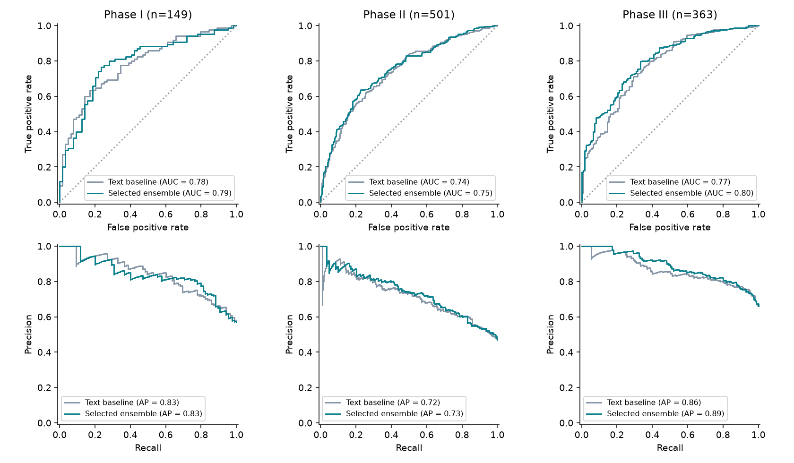
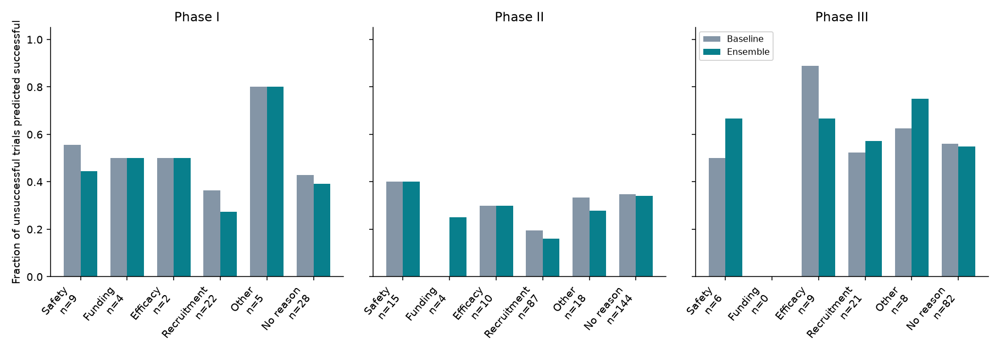

# Part Two: clinical-trial outcome prediction

**Latest recommendation: hold 05/06.** Ani's published 0.58688 model has now been reproduced. Use the [repeatable local benchmark](LOCAL_TESTING.md), [executed benchmark notebook](local_benchmark.ipynb), and [complete results](experiments/local_benchmark/RESULTS.md) for new comparisons. The original selection below is historical. Optional Ani-anchored candidates are documented in [ani_candidates_manifest.json](submissions/ani_candidates_manifest.json); their Kaggle scores remain unknown.

Prepared four initial manual Kaggle submissions and two follow-ups. **Lower log loss is better.** The best reported reference score is **0.58688**. Our `03_phase_specialized.csv` scored **0.59562**; `02_text_heavy.csv` improved to **0.58993**, still 0.00305 behind the reference. Initial candidates 01 and 04 have unknown Kaggle scores. Results are recorded against exact file hashes in [submissions/leaderboard_results.json](submissions/leaderboard_results.json).

## Evaluation protocol

Train: 8,037 rows / 7,535 trials. Supplied validation: 1,013 rows / 901 trials. Test: 1,500 rows, exactly 500 per phase. No trial crosses these files. Combined-phase rows stay together.

The chronological check trains on 5,660 rows starting through 2008 and evaluates on 2,377 training-file rows starting in 2009-2013. Every TF-IDF vocabulary, IDF, SVD, and metadata vocabulary is fitted only on that split's training population. Final models use **outcome_train.csv only**. No validation labels enter their fitting.

Selection compares the equal mean of the three per-phase log losses, matching Kaggle's phase proportions. The supplied validation set itself has unequal phase counts, so its ordinary row-weighted log loss is also saved but is not the selection objective. Both local splits are consulted for selection; neither is an untouched final assessment. Model selection across many settings can overfit these evaluations.

## Methods and comparisons

Evaluated 318 matching individual configurations (including pooled/separate-model blends) across both splits and 434 fixed-weight ensemble configurations. Compare word and character TF-IDF, binary word features, clinical metadata, drug targets/actions/pathways, Morgan fingerprints and molecular descriptors, pooled and separate phase models, shared phase interactions, phase balancing, newer-trial weighting, raw/capped year effects, and NB log-ratio features. Classifiers include L2 logistic regression, CatBoost, histogram gradient boosting, sparse LightGBM, and Extra Trees. No deep learning or external outcome data is used.

The baseline is eligibility-criteria TF-IDF (unigrams/bigrams, at most 35,000 terms, minimum document frequency 3, sublinear TF), three phase indicators, and pooled L2 logistic regression with C=2. All F1 values below use cutoff 0.5. ROC-AUC and PR-AUC use probabilities, with success (label=1) as positive. PR-AUC means average precision.

Text models share signal across phases. Separate phase fits and phase interactions can overfit the smaller Phase I population. Molecular fingerprints do not consistently improve the text/clinical control. Raw year extrapolation is sensitive to the historical success trend; the capped-year alternative stops its effect at the latest observed training year. Drug annotations are less common in test (39.3%) than training (45.7%), so relying heavily on them risks a coverage shift. These patterns motivate mixed text/tree candidates and an explicit temporal comparison.

## Initial four submission candidates

| submission | validation_logloss | temporal_logloss | mean_test_probability | kaggle_score |
| --- | --- | --- | --- | --- |
| 01_balanced_ensemble.csv | 0.55413 | 0.55258 | 0.61315 |  |
| 02_text_heavy.csv | 0.55359 | 0.55783 | 0.61878 | 0.58993 |
| 03_phase_specialized.csv | 0.55126 | 0.55328 | 0.61460 | 0.59562 |
| 04_capped_year.csv | 0.55397 | 0.55387 | 0.63339 |  |

`03_phase_specialized.csv` was the lowest joint-loss candidate before Kaggle evaluation, but its local advantage did not transfer. 02 improved the leaderboard score by reducing tree influence in Phases II/III. That motivated diagnostic files 05/06, now **on hold**: our linear endpoint is worse than Ani in the new chronological comparisons. Their historical recipes remain in [submissions/followup_manifest.json](submissions/followup_manifest.json). The new benchmark compares strict fold-local preprocessing and Ani's faithful transductive recipe on the same ten saved splits. Optional 07 is a mild interpolation toward Ani's Phase III trend variant; 08 is an Ani-heavy linear blend. Read their paired uncertainty before submitting. Original files are preserved. Initial 01–06 use 8,037 supervised training rows; Ani's reference and the new final linear component use 9,050 train+validation rows after separate held-out evaluation. Reduced temporal fits are never submitted.

## Per-phase baseline and modification

| model | phase | n | log_loss | f1 | roc_auc | pr_auc |
| --- | --- | --- | --- | --- | --- | --- |
| baseline | I | 149 | 0.55619 | 0.76503 | 0.78346 | 0.83490 |
| baseline | II | 501 | 0.59967 | 0.65672 | 0.74009 | 0.71735 |
| baseline | III | 363 | 0.52938 | 0.83302 | 0.77419 | 0.86243 |
| 03_phase_specialized | I | 149 | 0.55991 | 0.77528 | 0.78952 | 0.83186 |
| 03_phase_specialized | II | 501 | 0.58893 | 0.66809 | 0.75061 | 0.73351 |
| 03_phase_specialized | III | 363 | 0.50493 | 0.82576 | 0.79966 | 0.88611 |

## Stopping-reason error analysis

Only unsuccessful validation rows are included. Their `trial_id` is matched to Part One's `ID` after outcome prediction. Use visible Part One train/validation labels when available; otherwise use the frozen original DBSCAN/logistic Part One model (157 verified training labels, C=1000, cutoff 0.5 with argmax fallback). The exact source model and checksum are recorded in `reason_model_provenance.json`. **Reason embeddings, reason labels, and membership in Part One never enter an outcome classifier.**

Rows absent from Part One form the separate no-recorded-stopping-reason group. Reasons overlap, so group counts need not sum to the number of failures. Each trial is counted at most once within a phase. Funding has no Phase III examples; its rate is undefined, not zero.

The baseline incorrectly predicts success for 8 of 9 Phase III efficacy-tagged failures. All nine tags are model predictions, so this is an uncertain subgroup signal. To address the baseline's restricted eligibility-only view, the comparisons add clinical and molecular context and nonlinear combinations, then blend probabilities to retain text generalization. The final table shows the modification's actual trade-offs; improvement in overall log loss need not improve every reason category or F1 at a fixed threshold.

| phase | reason | n | baseline false-success | ensemble false-success | true reason rows | predicted reason rows |
| --- | --- | --- | --- | --- | --- | --- |
| I | Safety | 9 | 5 | 4 | 1 | 8 |
| I | Funding | 4 | 2 | 2 | 1 | 3 |
| I | Efficacy | 2 | 1 | 1 | 0 | 2 |
| I | Recruitment | 22 | 8 | 6 | 2 | 20 |
| I | Other | 5 | 4 | 4 | 0 | 5 |
| I | No recorded stopping reason | 28 | 12 | 11 | 0 | 0 |
| II | Safety | 15 | 6 | 6 | 1 | 14 |
| II | Funding | 4 | 0 | 1 | 1 | 3 |
| II | Efficacy | 10 | 3 | 3 | 0 | 10 |
| II | Recruitment | 87 | 17 | 14 | 12 | 75 |
| II | Other | 18 | 6 | 5 | 3 | 15 |
| II | No recorded stopping reason | 144 | 50 | 49 | 0 | 0 |
| III | Safety | 6 | 3 | 4 | 1 | 5 |
| III | Funding | 0 | 0 | 0 | 0 | 0 |
| III | Efficacy | 9 | 8 | 6 | 0 | 9 |
| III | Recruitment | 21 | 11 | 12 | 5 | 16 |
| III | Other | 8 | 5 | 6 | 2 | 6 |
| III | No recorded stopping reason | 82 | 46 | 45 | 0 | 0 |

Per-category rates, Wilson intervals, known/predicted-label counts, and all four candidates are saved in `experiments/model_search/*reason_errors.csv`. Small groups and predicted reason-label errors limit category-level conclusions. The paired trial-level bootstrap is descriptive and uses the same validation population used for selection.

## Reproduce

Open [part2.ipynb](part2.ipynb). It contains the complete module source plus the executed evaluation and figures. Set `RUN_TRAINING=True` to rerun all searches; the default reads the saved results. Install the pinned [requirements.txt](requirements.txt) in a virtual environment.

Run each search script, then `ensemble_search.py`, preserve the selected mapping in `experiments/model_search/selected_ensembles.json`, run `submission_models.py`, `error_analysis.py`, and `reporting.py`. `model_replay_verification.csv` checks independent linear refits and saved-model reloads against both stored validation and test probabilities. All exported files are checked for 1,500 unique IDs in sample-submission order, finite probabilities strictly between 0 and 1, exact column names, and CSV round-trip agreement.

For inference from the saved bundle: `python submission_models.py --input outcome_test.csv --output replayed_predictions`.

This directory supplies the Part Two implementation and report material. Integrate it with the team's Part One results in the required project report (maximum five pages, excluding references).
