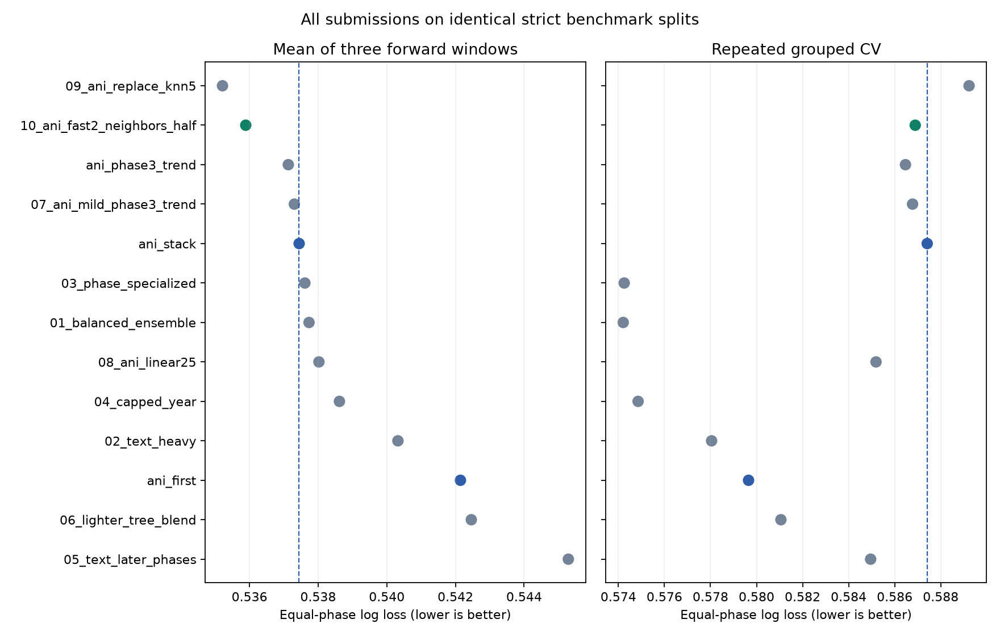

# All Part Two submissions on the same fixed benchmark

**Complete:** all ten numbered recipes, both Kaggle-scored Ani references, and
Ani's trend control, on the same ten original splits and three longer-gap splits.
Every table uses identical evaluation trials and equal-phase log loss. Lower is
better. These are frozen recipes; this run did not tune or generate submissions.

**Later Kaggle result:** `13_file10_legacy30.csv` scored **0.58465**, improving Ani's 0.58688 by **0.00223**. The user reported rank 1. This result was reported after the frozen comparison. Local predictions and selection evidence are unchanged. The current ledger supplies the Kaggle column; its original input snapshot is preserved with the run.

## Primary strict comparison

Every model fits preprocessing on its fitting rows only. `official` is the
supplied validation set; `temporal` averages the three original forward windows;
`worst` is the worst of those windows; `cv` pools held-out rows within each of two
grouped-CV repeats; `gap_mean` averages the three longer-gap windows. Known Kaggle
scores belong to the original file hashes, not these fold refits.

| model | official | temporal | worst | cv | gap_mean | kaggle |
| --- | --- | --- | --- | --- | --- | --- |
| 01_balanced_ensemble | 0.554134 | 0.537734 | 0.586815 | 0.574210 | 0.567924 | Unknown |
| 02_text_heavy | 0.553592 | 0.540324 | 0.588906 | 0.578048 | 0.568506 | 0.589930 |
| 03_phase_specialized | 0.551255 | 0.537613 | 0.586144 | 0.574253 | 0.568270 | 0.595620 |
| 04_capped_year | 0.553970 | 0.538620 | 0.588823 | 0.574856 | 0.565622 | Unknown |
| 05_text_later_phases | 0.558605 | 0.545290 | 0.594677 | 0.584955 | 0.572981 | Unknown |
| 06_lighter_tree_blend | 0.555718 | 0.542462 | 0.591366 | 0.581058 | 0.570345 | Unknown |
| 07_ani_mild_phase3_trend | 0.555034 | 0.537306 | 0.588557 | 0.586776 | 0.563816 | Unknown |
| 08_ani_linear25 | 0.553327 | 0.538022 | 0.588732 | 0.585189 | 0.565438 | Unknown |
| ani_first | 0.557370 | 0.542145 | 0.590898 | 0.579653 | 0.568041 | 0.588100 |
| ani_stack | 0.555039 | 0.537446 | 0.588574 | 0.587411 | 0.564681 | 0.586880 |
| ani_phase3_trend | 0.556030 | 0.537131 | 0.588951 | 0.586468 | 0.562422 | Unknown |
| 09_ani_replace_knn5 | 0.560796 | 0.535213 | 0.586014 | 0.589230 | 0.563657 | Unknown |
| 10_ani_fast2_neighbors_half | 0.557839 | 0.535890 | 0.587101 | 0.586891 | 0.563189 | 0.586090 |

## File 10 versus the actual non-Ani submissions

File 02 is the best scored non-Ani submission (Kaggle 0.58993); file 03 scored
0.59562. Their full original ensembles, including both CatBoost models, are now
evaluated directly. No linear-component proxy is substituted for either recipe.

For file 10 minus file 02 under strict preprocessing, the log-loss differences
are: supplied validation **+0.004248**, chronological mean
**-0.004434**, grouped CV **+0.008844**, and longer-gap mean
**-0.005317**. Negative favors file 10; positive favors file 02.

File 10's number of winning periods, with the same trial IDs in each pair:

| reference | forward_wins | forward_windows | gap_wins | gap_windows |
| --- | --- | --- | --- | --- |
| 02_text_heavy | 3 | 3 | 3 | 3 |
| 03_phase_specialized | 1 | 3 | 2 | 3 |
| ani_stack | 3 | 3 | 3 | 3 |

An average gain does not imply winning every period. In particular, file 03
beats file 10 in the first two original forward windows, while file 10 wins the
latest window by a larger margin. Retain this temporal variation when judging
whether the gains will transfer to a future cohort.

The old files' single historical temporal scores are not used in this table.
Files 01–06 originally trained their final submissions on 8,037 rows, while Ani
and 07–10 used 9,050. All recipes here receive the same fitting rows in each
split. That resolves the local population mismatch without inventing a Kaggle
score for a hypothetical refit of file 02.



## Secondary original-recipe preprocessing comparison

This track preserves Ani/09/10 feature-only transduction and legacy training-only
preprocessing. Files 01–06 are therefore identical to the strict track; 07/08 use
the corresponding Ani predictions. This sensitivity table has matched supervised
fitting and evaluation rows but deliberately retains different original feature
policies. Use the strict table for common-preprocessing comparisons.

| model | official | temporal | worst | cv | gap_mean | kaggle |
| --- | --- | --- | --- | --- | --- | --- |
| 01_balanced_ensemble | 0.554134 | 0.537734 | 0.586815 | 0.574210 | 0.567924 | Unknown |
| 02_text_heavy | 0.553592 | 0.540324 | 0.588906 | 0.578048 | 0.568506 | 0.589930 |
| 03_phase_specialized | 0.551255 | 0.537613 | 0.586144 | 0.574253 | 0.568270 | 0.595620 |
| 04_capped_year | 0.553970 | 0.538620 | 0.588823 | 0.574856 | 0.565622 | Unknown |
| 05_text_later_phases | 0.558605 | 0.545290 | 0.594677 | 0.584955 | 0.572981 | Unknown |
| 06_lighter_tree_blend | 0.555718 | 0.542462 | 0.591366 | 0.581058 | 0.570345 | Unknown |
| 07_ani_mild_phase3_trend | 0.556118 | 0.535617 | 0.587627 | 0.584866 | 0.562949 | Unknown |
| 08_ani_linear25 | 0.553741 | 0.536658 | 0.587988 | 0.583451 | 0.564789 | Unknown |
| ani_first | 0.558898 | 0.540625 | 0.588684 | 0.577507 | 0.568040 | 0.588100 |
| ani_stack | 0.556108 | 0.535751 | 0.587659 | 0.585465 | 0.563803 | 0.586880 |
| ani_phase3_trend | 0.557150 | 0.535460 | 0.587985 | 0.584607 | 0.561546 | Unknown |
| 09_ani_replace_knn5 | 0.561697 | 0.533687 | 0.586055 | 0.587178 | 0.562923 | Unknown |
| 10_ani_fast2_neighbors_half | 0.559173 | 0.534547 | 0.586828 | 0.585453 | 0.562306 | 0.586090 |

## Paired uncertainty for file 10

Every difference below uses the same held-out trials for both models. Repeated
CV losses are averaged per row before resampling; all phase rows of a trial share
bootstrap weights. These intervals are descriptive and do not correct for earlier
adaptive model selection. The longer-gap labels were also consulted previously.

| reference | suite | kind | delta | lower | upper |
| --- | --- | --- | --- | --- | --- |
| 02_text_heavy | main | temporal | -0.004434 | -0.010836 | 0.002037 |
| 02_text_heavy | main | group_cv | 0.008844 | 0.005142 | 0.012683 |
| 02_text_heavy | gaps | temporal | -0.005317 | -0.011461 | 0.000652 |
| 03_phase_specialized | main | temporal | -0.001723 | -0.008787 | 0.005181 |
| 03_phase_specialized | main | group_cv | 0.012639 | 0.008451 | 0.016909 |
| 03_phase_specialized | gaps | temporal | -0.005080 | -0.012430 | 0.001875 |
| ani_first | main | temporal | -0.006255 | -0.010857 | -0.001717 |
| ani_first | main | group_cv | 0.007238 | 0.003904 | 0.010701 |
| ani_first | gaps | temporal | -0.004852 | -0.008781 | -0.001256 |
| ani_stack | main | temporal | -0.001556 | -0.003842 | 0.000791 |
| ani_stack | main | group_cv | -0.000520 | -0.001642 | 0.000661 |
| ani_stack | gaps | temporal | -0.001492 | -0.003453 | 0.000387 |

The complete [paired comparison table](runs/8f68385e25e07615/paired_comparisons.csv)
contains file 10 versus every alternative under both tracks. The
[window-level scores](runs/8f68385e25e07615/all_fold_scores.csv) retain every period and
phase, including unfavorable results.
All-model difference matrices are also saved for each metric and track; for
example, [strict chronological differences](runs/8f68385e25e07615/pairwise_strict_temporal.csv).
Each matrix cell is row-model loss minus column-model loss; negative favors the row.

## Fidelity, verification and reproduction

Original ensemble weights come directly from the original manifests. The legacy
adapter preserves text features, capped-year behavior, SVD dimensions, fixed tree
counts, recency half-lives and seeds. Vocabulary/IDF, SVD and metadata masks are
rebuilt on each fold's fitting rows. Already-scored Ani/09/10 predictions are
reused with source, input, split and probability checks; they are not refit with
different settings. Original submission CSVs are unchanged.

[Original replay](runs/8f68385e25e07615/original_replay.csv) compares all six original
components on supplied validation and all six numbered legacy test CSVs against
the rebuilt official-training model. [Verification](runs/8f68385e25e07615/verification.json)
independently rescores all 338 model/split/track results, checks trial boundaries,
fixed blends, source hashes and inference invariance to IDs and outcome labels.

```sh
uv pip install --python .venv/bin/python -r part2/requirements-all-submissions.txt
.venv/bin/python part2/all_submissions_benchmark.py --workers 2
.venv/bin/python part2/all_submissions_verify.py
.venv/bin/python part2/all_submissions_report.py
```

See [comparison policy](../../ALL_SUBMISSIONS_PROTOCOL.md),
[executed notebook](../../all_submissions.ipynb),
[strict machine-readable table](runs/8f68385e25e07615/comparison_strict.csv), and
[source/input manifest](runs/8f68385e25e07615/manifest.json). Native caches are ignored
by Git and can be rebuilt; per-row held-out predictions and fitting IDs are saved.
This benchmark does not upload submissions. Later user-reported Kaggle results
are joined by exact submission hashes from the current ledger.
