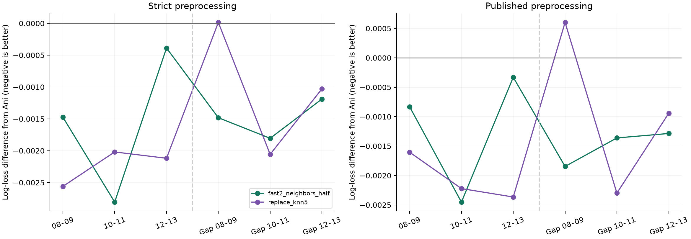

# New Part Two candidates: recent, sharper neighbors

**Try `10_ani_fast2_neighbors_half.csv` first.** It improves all six chronological windows under both preprocessing policies, with a small grouped-CV improvement over Ani's 0.58688 model. `09_ani_replace_knn5.csv` has the strongest improvement on the original three forward windows, but a small grouped-CV regression. These are local results; **both new Kaggle scores are unknown**.

## What the earlier search missed

The first round tested slower recency and many calibration changes while retaining Ani's nearest-neighbor estimator. That estimator ignores recency, uses linear text similarities, and shrinks toward a fixed 50% success rate. The previous promotion rule also demanded near-best random CV from the unweighted model, despite its weaker chronological and reported Kaggle results. This round preserves that history and uses a separately declared rule that prioritizes later-cohort prediction. No old result was relabeled as new evidence.

## Changes that helped

**File 09** retains Ani's seven other base estimators and replaces only the kNN input before refitting his logistic stack. For the 50 most similar trials in the same phase, it squares similarity relative to the closest match, weights recent trials more strongly (exponential tau=3), and shrinks toward a smoothed training-only success prior for that phase. All neighbor labels, priors, vocabularies and IDF values are rebuilt inside each grouped inner fold.

**File 10** averages Ani's original stack with a tau=2 stack that also receives eight neighborhood estimates: several neighborhood sizes, recent weighting, sharper text similarity, and combined criteria/disease/drug/ICD similarity. The probability blend is fixed at 50/50. Its OOF meta-model is regularized with C=0.3.

For file 09, neighbor weights are `(similarity / best_similarity)^2 × recency_weight`. Recency weights have mean one within the fitting phase. The phase prior is `(weighted_successes + 1) / (total_weight + 2)`, and the neighbor probability is `(weighted_neighbor_successes + 2 × prior) / (neighbor_weight + 2)`. With no overlapping text, prediction falls back to the fitted phase prior.

## Identical-split comparison

Lower log loss is better. All tables score the exact same held-out trials, with equal phase weighting. Random grouped CV is pooled within each repeat. `official` is the supplied validation set; `temporal` averages the three original forward windows; `worst` is the worst forward window.

### Strict

| model | official | temporal | worst | cv |
| --- | --- | --- | --- | --- |
| ani_stack | 0.555039 | 0.537446 | 0.588574 | 0.587411 |
| ani_first | 0.557370 | 0.542145 | 0.590898 | 0.579653 |
| ani_phase3_trend | 0.556030 | 0.537131 | 0.588951 | 0.586468 |
| replace_knn5 | 0.560796 | 0.535213 | 0.586014 | 0.589230 |
| fast2_neighbors_half | 0.557839 | 0.535890 | 0.587101 | 0.586891 |

### Published

| model | official | temporal | worst | cv |
| --- | --- | --- | --- | --- |
| ani_stack | 0.556108 | 0.535751 | 0.587659 | 0.585465 |
| ani_first | 0.558898 | 0.540625 | 0.588684 | 0.577507 |
| ani_phase3_trend | 0.557150 | 0.535460 | 0.587985 | 0.584607 |
| replace_knn5 | 0.561697 | 0.533687 | 0.586055 | 0.587178 |
| fast2_neighbors_half | 0.559173 | 0.534547 | 0.586828 | 0.585453 |

Both proposals improve the original forward windows against the recency winner in all three periods. The supplied validation score worsens, and file 09's CV worsens. Those trade-offs are retained in the table rather than hidden. Ani's unweighted winner still has lower grouped-CV loss than these candidates; its chronological loss is higher.

## Frozen-shortlist checks at larger time gaps

The two recipes were frozen before scoring their predictions on the three larger-gap tests: train through 2005/evaluate 2008–2009, through 2007/evaluate 2010–2011, and through 2009/evaluate 2012–2013. These labels were used in earlier research; the checks are robustness evidence, not an untouched independent test.

### Strict

| model | temporal | worst |
| --- | --- | --- |
| ani_stack | 0.564681 | 0.630298 |
| ani_first | 0.568041 | 0.633776 |
| ani_phase3_trend | 0.562422 | 0.627050 |
| replace_knn5 | 0.563657 | 0.630312 |
| fast2_neighbors_half | 0.563189 | 0.628816 |

### Published

| model | temporal | worst |
| --- | --- | --- |
| ani_stack | 0.563803 | 0.628274 |
| ani_first | 0.568040 | 0.633129 |
| ani_phase3_trend | 0.561546 | 0.625192 |
| replace_knn5 | 0.562923 | 0.628877 |
| fast2_neighbors_half | 0.562306 | 0.626429 |

File 10 wins all three additional windows in both tracks. File 09 improves their average but slightly worsens the first gap. Ani's unsubmitted Phase III trend control remains better on the *average of these longer-gap tests*; the new candidates are better on the original forward windows. This prevents claiming dominance over every alternative.



## Uncertainty

Paired trial bootstraps share weights across phase rows and average repeated-CV losses before resampling. The chronological confidence intervals versus Ani include zero. These gains are promising local point estimates, not proof of a Kaggle improvement. Selection across this and earlier research is adaptive, and the intervals do not correct for it.

| model | kind | delta | lower | upper |
| --- | --- | --- | --- | --- |
| replace_knn5 | temporal | -0.002233 | -0.005094 | 0.000547 |
| replace_knn5 | group_cv | 0.001819 | 0.000202 | 0.003439 |
| fast2_neighbors_half | temporal | -0.001556 | -0.003842 | 0.000791 |
| fast2_neighbors_half | group_cv | -0.000520 | -0.001642 | 0.000661 |

All paired comparisons, including against the earlier 0.58810 winner, are in [paired_comparisons.csv](decision/paired_comparisons.csv). Larger-gap intervals are stored separately under each track's `gaps` directory.

## Required per-phase and stopping-reason diagnostics

Supplied-validation metrics for the recommended candidate and Ani's recency model, under strict preprocessing:

| model | phase | logloss | f1 | roc_auc | pr_auc |
| --- | --- | --- | --- | --- | --- |
| ani_stack | I | 0.555754 | 0.792899 | 0.793750 | 0.829987 |
| ani_stack | II | 0.592863 | 0.646925 | 0.753486 | 0.732118 |
| ani_stack | III | 0.516499 | 0.824859 | 0.789804 | 0.881745 |
| fast2_neighbors_half | I | 0.560222 | 0.761905 | 0.786949 | 0.824039 |
| fast2_neighbors_half | II | 0.592614 | 0.637615 | 0.753822 | 0.729628 |
| fast2_neighbors_half | III | 0.520682 | 0.829268 | 0.785976 | 0.876879 |

Counts of unsuccessful validation trials incorrectly predicted successful at cutoff 0.5:

| phase | reason | n | true_reason_rows | predicted_reason_rows | false_success_ani | false_success_candidate |
| --- | --- | --- | --- | --- | --- | --- |
| I | Safety | 9 | 1 | 8 | 3 | 3 |
| I | Funding | 4 | 1 | 3 | 0 | 1 |
| I | Efficacy | 2 | 0 | 2 | 2 | 2 |
| I | Recruitment | 22 | 2 | 20 | 2 | 2 |
| I | Other | 5 | 0 | 5 | 2 | 2 |
| I | No recorded stopping reason | 28 | 0 | 0 | 9 | 10 |
| II | Safety | 15 | 1 | 14 | 5 | 5 |
| II | Funding | 4 | 1 | 3 | 0 | 0 |
| II | Efficacy | 10 | 0 | 10 | 3 | 3 |
| II | Recruitment | 87 | 12 | 75 | 13 | 11 |
| II | Other | 18 | 3 | 15 | 4 | 4 |
| II | No recorded stopping reason | 144 | 0 | 0 | 39 | 41 |
| III | Safety | 6 | 1 | 5 | 3 | 3 |
| III | Funding | 0 | 0 | 0 | 0 | 0 |
| III | Efficacy | 9 | 0 | 9 | 9 | 9 |
| III | Recruitment | 21 | 5 | 16 | 11 | 11 |
| III | Other | 8 | 2 | 6 | 5 | 5 |
| III | No recorded stopping reason | 82 | 0 | 0 | 47 | 47 |

Reason tags are joined only after predicting. Visible true tags and frozen Part One predictions are distinguished; categories overlap and small groups are uncertain. Full rates and Wilson intervals are in [reason_errors.csv](decision/reason_errors.csv). No identifiers, stopping-reason labels or reason embeddings enter a predictor.

## Reproduction and complete record

This round tested **40 extension recipes**, each on ten frozen splits under two preprocessing policies: **800 new recipe evaluations**, plus unchanged controls. All proposals, including failures, are in [all_comparisons.csv](decision/all_comparisons.csv). The shallow nonlinear stacks did not improve temporal loss; faster recency alone also produced mixed results. The neighbor changes supply the useful gain.

[Selection and source manifests](decision/selection.json) preserve recipe definitions, hashes and source runs. [Verification](decision/verification.json) checks fitting boundaries, all saved scores, and unchanged controls. Native model replay has maximum probability difference 0; changing evaluation labels/IDs does not alter inference. All 16 unit checks passed.

Final fits use all 9,050 labeled rows and the same feature-only transductive preprocessing as Ani. Each CSV has exactly 1,500 unique IDs in sample-submission order, finite probabilities, and columns `ID,label`. The original Ani files remain intact.

- [09_ani_replace_knn5.csv](../../submissions/09_ani_replace_knn5.csv): Kaggle score unknown; SHA-256 `2aef6030c184ea3dbb0fa271519e2330d61bb9853bd7c63b2baab8f18f9ea75d`.
- [10_ani_fast2_neighbors_half.csv](../../submissions/10_ani_fast2_neighbors_half.csv): Kaggle score unknown; SHA-256 `d6fa9e347cbb670d3c190b2cf387dcdd06d42d92930bae8abc35974e2b648448`.

```sh
# From repository root, with part2/requirements-benchmark.txt installed in .venv:
.venv/bin/python part2/extension_meta.py --track strict
.venv/bin/python part2/extension_meta.py --track published
.venv/bin/python part2/extension_neighbors.py --track strict
.venv/bin/python part2/extension_neighbors.py --track published
.venv/bin/python part2/extension_followthrough.py select
.venv/bin/python part2/extension_followthrough.py compare
.venv/bin/python part2/extension_followthrough.py gaps --track strict
.venv/bin/python part2/extension_followthrough.py gaps --track published
.venv/bin/python part2/extension_followthrough.py final
.venv/bin/python part2/extension_verify.py
.venv/bin/python -m unittest discover -s part2 -p 'test_*.py'
.venv/bin/python part2/extension_predict.py --input part2/outcome_test.csv --output /tmp/replayed.csv
```

Native caches are regenerable and ignored by Git. Existing OOF arrays and fitting IDs permit replay without retraining the original base models. If the old final native cache is missing, final fitting rebuilds it. [Notebook with embedded implementation source](../../ani_extensions.ipynb).
