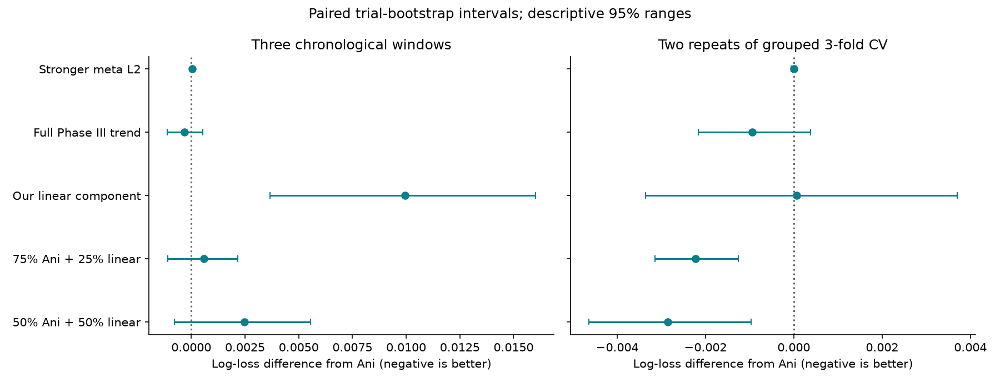
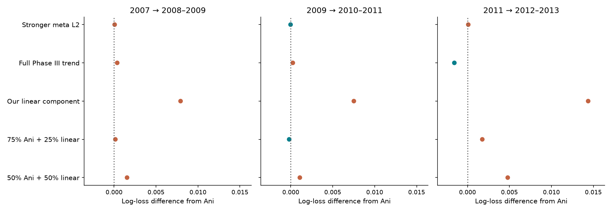

# Part Two benchmark results

**Hold 05.** Its underlying linear component should be judged against Ani on the saved chronological and grouped splits, not inferred to win by extrapolating two leaderboard scores. The best confirmed reference remains Ani's **0.58688**; our reported scores are **02: 0.58993**, **03: 0.59562**.

Ani commit: `1b8bd11c47428fb5453e53cdc275542b92a3b347`. Exact final-submission reproduction has maximum probability difference **3.54e-09** from the published CSV. The source notebook, CSVs and hashes are preserved in `experiments/ani_comparison`.

## Strict comparison on the same saved splits

| model | official_logloss | temporal_mean_logloss | worst_temporal_logloss | cv_mean_logloss | temporal_mean_delta_vs_ani | cv_mean_delta_vs_ani |
| --- | --- | --- | --- | --- | --- | --- |
| ani_phase3_trend | 0.556030 | 0.537131 | 0.588951 | 0.586468 | -0.000315 | -0.000943 |
| ani_stack | 0.555039 | 0.537446 | 0.588574 | 0.587411 | 0.000000 | 0.000000 |
| ani_meta_C0.3 | 0.555014 | 0.537492 | 0.588645 | 0.587410 | 0.000046 | -0.000001 |
| blend_ani75_linear25 | 0.553327 | 0.538022 | 0.588732 | 0.585189 | 0.000577 | -0.002222 |
| blend_ani50_linear50 | 0.553325 | 0.539920 | 0.590122 | 0.584561 | 0.002475 | -0.002850 |
| our_linear | 0.557787 | 0.547387 | 0.596500 | 0.587471 | 0.009941 | 0.000060 |

All ten splits are complete for every model. Features and stacking-inner preprocessing use fitting rows only. This adapts Ani's algorithm to a strict prospective evaluation. The three chronological windows are 2008–2009, 2010–2011 and 2012–2013, always fitting earlier years. Group CV uses two seeded repeats of three trial-grouped folds over the same labeled universe. Combined-phase rows stay together. Log loss is averaged equally across phases; CV is pooled across held-out rows within each repeat.

The 50/50 Ani/linear blend improves supplied validation and grouped CV, yet is worse on chronological mean loss. The linear endpoint is worse across time. This warns against using either validation F1 or random CV alone to choose a submission.

Negative differences favor the candidate. Intervals spanning zero indicate inconclusive local evidence. The ranges are conditional, descriptive trial bootstraps, not guarantees for a future cohort or corrections for model selection.

## Faithful published-recipe sensitivity track

| model | official_logloss | temporal_mean_logloss | worst_temporal_logloss | cv_mean_logloss | temporal_mean_delta_vs_ani | cv_mean_delta_vs_ani |
| --- | --- | --- | --- | --- | --- | --- |
| ani_phase3_trend | 0.557150 | 0.535460 | 0.587985 | 0.584607 | -0.000291 | -0.000858 |
| ani_stack | 0.556108 | 0.535751 | 0.587659 | 0.585465 | 0.000000 | 0.000000 |
| blend_ani75_linear25 | 0.553741 | 0.536658 | 0.587988 | 0.583451 | 0.000907 | -0.002014 |
| blend_ani50_linear50 | 0.553374 | 0.538947 | 0.589581 | 0.583238 | 0.003196 | -0.002228 |
| our_linear | 0.557787 | 0.547387 | 0.596500 | 0.587471 | 0.011636 | 0.002006 |

This track preserves Ani's feature-only transduction: vocabulary/IDF sees all available train/validation/test text. Evaluation outcome labels never fit a model. These results are kept separate from strict scores. Both tracks reuse the exact same trial splits. Original Ani submission refits supervised models on 9,050 train+validation rows, whereas our initial submitted models fitted only 8,037 training rows. That difference also prevents attributing the leaderboard gap to the algorithm alone.

## Conservative follow-up comparisons

| track | model | official_logloss | temporal_mean_logloss | worst_temporal_logloss | cv_mean_logloss | temporal_mean_delta_vs_ani | cv_mean_delta_vs_ani |
| --- | --- | --- | --- | --- | --- | --- | --- |
| Strict | ani_mild_phase3_trend | 0.555034 | 0.537306 | 0.588557 | 0.586776 | -0.000140 | -0.000635 |
| Strict | ani_stack | 0.555039 | 0.537446 | 0.588574 | 0.587411 | 0.000000 | 0.000000 |
| Strict | ani_anchored_linear25 | 0.553327 | 0.538022 | 0.588732 | 0.585189 | 0.000577 | -0.002222 |
| Published recipe | ani_mild_phase3_trend | 0.556118 | 0.535617 | 0.587627 | 0.584866 | -0.000134 | -0.000599 |
| Published recipe | ani_stack | 0.556108 | 0.535751 | 0.587659 | 0.585465 | 0.000000 | 0.000000 |
| Published recipe | ani_anchored_linear25 | 0.553741 | 0.536658 | 0.587988 | 0.583451 | 0.000907 | -0.002014 |

These are exploratory fixed blends, evaluated on every saved split. The mild trend interpolates 25% toward Ani's existing Phase III trend alternative; the linear blend puts 25% weight on our linear component. If using another exploratory submission, prefer optional **07_ani_mild_phase3_trend.csv** over 05: it remains anchored to Ani's known winning file and has favorable point differences in both tracks. Its temporal interval still includes zero. The linear blend improves grouped CV but is less consistent across time. Neither candidate has a known Kaggle score; preserve Ani's 0.58688 as the confirmed reference.

## Repeatability and future candidates

See [LOCAL_TESTING.md](../../docs/LOCAL_TESTING.md) for protocol, commands and limitations. `protocol.json` contains immutable IDs, grouping, seeds, periods and data hashes. Each run records implementation hashes and package versions. Models and exact held-out predictions are cached. `fold_scores.csv`, `summary.csv`, per-fold `audit.json`, and prediction files make independent rescoring possible. Incomplete runs cannot be presented as completed comparisons.

Use this suite for the next candidate batch. Do not choose one favorable validation F1 or change boundaries to make a model win. Freeze the recipe before generating a final CSV; refit final components consistently on train plus validation, while keeping held-out benchmark metrics separate. Kaggle results remain the only direct evidence of performance on its newer cohort.
