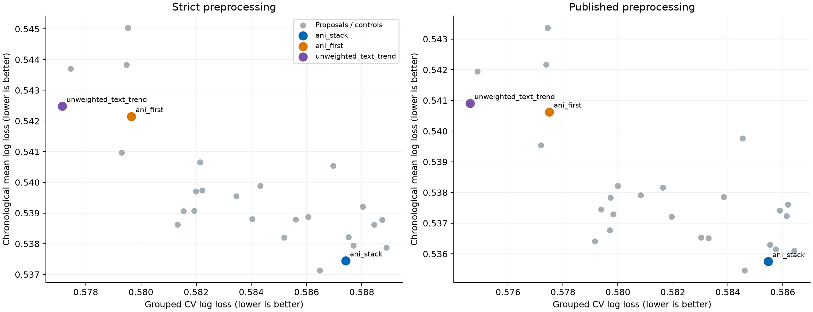
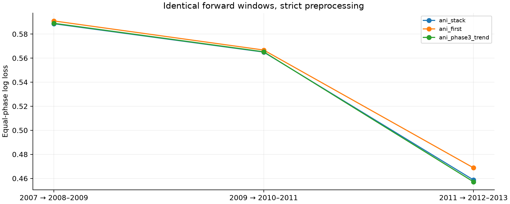

# Part Two: both Ani winners and proposed improvements

**Retain Ani's 0.58688 submission. No new recipe passed the rule fixed before testing, so no new numbered Kaggle submission was promoted or added.**

Both original winners were reproduced: unweighted stack **0.58810** and recency-weighted stack **0.58688** Kaggle log loss. These scores are tied to the archived CSV hashes and Ani's commit messages, not a fresh leaderboard query. New local scores are not Kaggle results.

## What was tested

27 recipes on the identical ten saved splits in each of two preprocessing tracks: **540 held-out recipe/split evaluations**. These comprise both winners, the existing Phase III trend control, and 24 other variants. A 13-recipe first batch tests weighting, calibration, interactions and mixtures; an adaptive eight-recipe batch adds capped years; a final adaptive six-recipe batch adds joint clinical-text and supervised word-ratio classifiers. All attempts are retained. No further search followed the gapped checks.

The strongest strict grouped-CV result is **unweighted_text_trend**, with loss **0.577144**, versus **0.579653** for Ani's unweighted stack. Its chronological mean is **0.542480**, versus **0.537446** for Ani's recency winner. This is a useful CV gain, but it does not justify replacing the model with better time-based performance.

Training folds exclude each held-out trial and all its phase rows. The strict track refits vocabulary/IDF inside stacking folds; the separately labeled published track preserves Ani's use of all available covariates for text preprocessing. Neither uses evaluation outcomes for fitting. All final fits use the same 9,050 labeled rows.

## Strict comparison

| model | official | temporal | worst | cv |
| --- | --- | --- | --- | --- |
| ani_stack | 0.555039 | 0.537446 | 0.588574 | 0.587411 |
| ani_first | 0.557370 | 0.542145 | 0.590898 | 0.579653 |
| ani_phase3_trend | 0.556030 | 0.537131 | 0.588951 | 0.586468 |
| tau6_stack | 0.553028 | 0.539075 | 0.588163 | 0.581930 |
| blend_winners50 | 0.554350 | 0.539065 | 0.589188 | 0.581539 |
| recent_joint_stack | 0.554882 | 0.538794 | 0.587332 | 0.585606 |
| recent_text_stack | 0.557325 | 0.539889 | 0.587476 | 0.584326 |
| unweighted_text_stack | 0.559384 | 0.543703 | 0.588585 | 0.577453 |
| unweighted_text_trend | 0.560547 | 0.542480 | 0.589020 | 0.577144 |

## Published-recipe sensitivity comparison

| model | official | temporal | worst | cv |
| --- | --- | --- | --- | --- |
| ani_stack | 0.556108 | 0.535751 | 0.587659 | 0.585465 |
| ani_first | 0.558898 | 0.540625 | 0.588684 | 0.577507 |
| ani_phase3_trend | 0.557150 | 0.535460 | 0.587985 | 0.584607 |
| tau6_stack | 0.554641 | 0.536767 | 0.586562 | 0.579704 |
| blend_winners50 | 0.555490 | 0.537443 | 0.587668 | 0.579385 |
| recent_joint_stack | 0.556598 | 0.536538 | 0.585025 | 0.583028 |
| recent_text_stack | 0.558898 | 0.538159 | 0.585632 | 0.581636 |
| unweighted_text_stack | 0.561538 | 0.541942 | 0.585493 | 0.574890 |
| unweighted_text_trend | 0.562579 | 0.540902 | 0.585982 | 0.574617 |

Full [strict table](runs/097ac8161372126d/text_followup/strict/independent_summary.csv) and [published table](runs/097ac8161372126d/text_followup/published/independent_summary.csv) include every attempted recipe. Lower is better. Temporal means give equal weight to windows and phases; CV pools predictions across folds within each repeat.

## Selection and uncertainty

The predeclared rule requires a lower chronological mean than **both** references, CV within 0.001 of the better reference, and worst-window loss within 0.003 of the better reference's worst loss. It is intentionally conservative. Ani's recency winner and unweighted winner can trade places between chronological and random grouped CV, so one favorable metric is insufficient.

[Paired intervals against both references](runs/097ac8161372126d/paired_comparisons.csv) resample whole trials and average repeated losses before resampling. They are descriptive and conditional, without correction for adaptive model selection. All supplied labels have been consulted; these are not untouched-test estimates.

| model | reference | kind | delta | lower | upper |
| --- | --- | --- | --- | --- | --- |
| ani_phase3_trend | ani_stack | temporal | -0.000315 | -0.001116 | 0.000466 |
| ani_phase3_trend | ani_stack | group_cv | -0.000943 | -0.002212 | 0.000325 |
| ani_phase3_trend | ani_first | temporal | -0.005015 | -0.008686 | -0.001390 |
| ani_phase3_trend | ani_first | group_cv | 0.006815 | 0.003899 | 0.009882 |
| unweighted_text_trend | ani_stack | temporal | 0.005034 | -0.000130 | 0.010018 |
| unweighted_text_trend | ani_stack | group_cv | -0.010267 | -0.013827 | -0.006786 |
| unweighted_text_trend | ani_first | temporal | 0.000334 | -0.003364 | 0.004070 |
| unweighted_text_trend | ani_first | group_cv | -0.002509 | -0.004422 | -0.000423 |

## Larger time-gap robustness checks

After freezing selection, fit through 2005/2007/2009 and evaluate 2008–2009/2010–2011/2012–2013, respectively. The additional gaps probe longer-range transport. Evaluation labels overlap prior checks; this is robustness evidence, not new independent data.

### Strict

| model | temporal | worst |
| --- | --- | --- |
| ani_first | 0.568041 | 0.633776 |
| ani_stack | 0.564681 | 0.630298 |

### Published

| model | temporal | worst |
| --- | --- | --- |
| ani_first | 0.568040 | 0.633129 |
| ani_stack | 0.563803 | 0.628274 |

## Reproduction and deliverables

All source/data hashes and fitting boundaries were checked. Maximum probability difference from the archived ten-split Ani predictions is 0. Maximum differences from original Kaggle CSV probabilities: ani_stack 3.5e-09, ani_first 2.4e-07. The final native model replay also verifies that changing IDs or evaluation labels cannot change predictions. All 13 protocol/scoring/model checks passed.

Reproduce with [IMPROVEMENT_PROTOCOL.md](../../IMPROVEMENT_PROTOCOL.md), pinned [requirements-benchmark.txt](../../requirements-benchmark.txt), and the [executed notebook](../../stack_improvements.ipynb). The original data, submissions, branch history, and ten split definitions are preserved.
